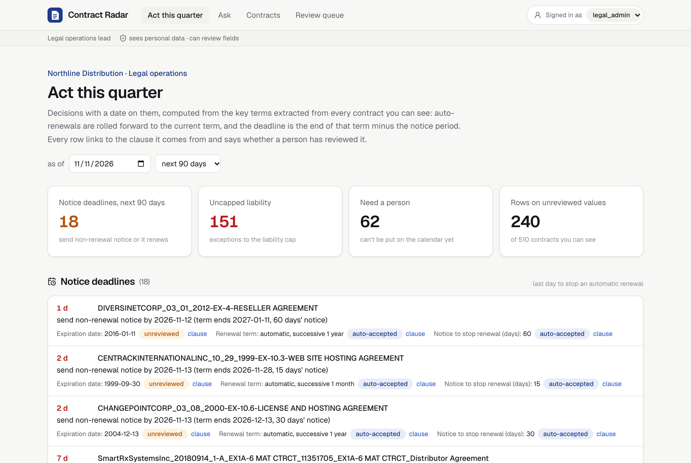
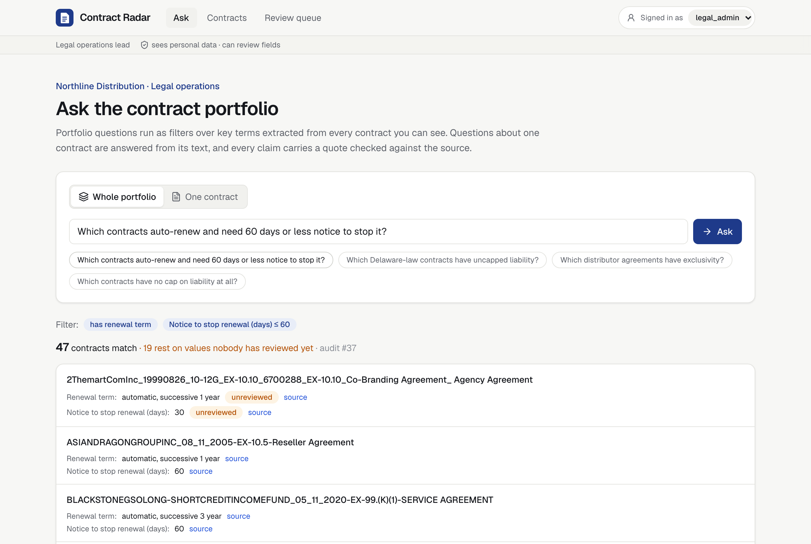
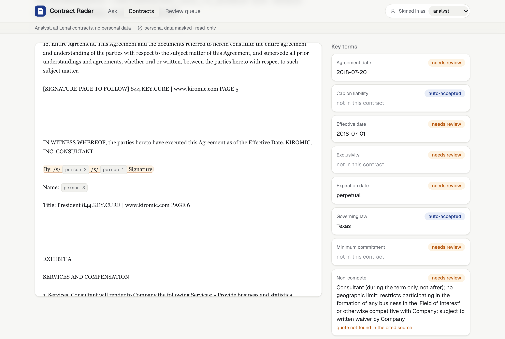

# Contract Radar

[](https://github.com/jpreyesm03/contract-radar/actions/workflows/ci.yml)

Ask questions across a portfolio of 510 real commercial contracts and get answers a lawyer can check: every claim
carries a quote that code verified against the contract, each user sees only the contracts they're allowed to, and
personal data is masked unless their role allows it. "Which contracts…?" questions run as filters over 13 key terms
extracted from every contract, with doubtful values routed to a person. Every question and every review is written to
a tamper-evident audit log.

> Data: the 510 public commercial contracts of [CUAD](https://www.atticusprojectai.org/cuad) (CC BY 4.0), filed with
> the SEC. The client, users and permissions are a demo scenario: see [CLIENT_BRIEF.md](CLIENT_BRIEF.md).







## Results

Held-out numbers unless marked dev; model Claude Haiku via the Claude CLI on a Claude plan, isolated configuration (one
sentence added to every prompt by an account-managed hook); costs are API-equivalent. How each was produced and what changed
when it failed: [DECISIONS.md](DECISIONS.md) (final run: D20). The runs behind each number:
[evals/results/](evals/results/).

| What | Result |
|---|---|
| **Retrieval** (5,506 lawyer-labeled clauses, 415 unseen contracts) | the clause in the top 8 for **89.1%** (keyword 68.6% → vector 71.7% → hybrid 74.6% → + reranker 83.9% → + query planning 89.1%) |
| **Cited answers** (dev, 50 questions) | answered 28/30 when the clause exists; the citation lands on the lawyers' span 26/28; says "not there" 19/20 when it isn't (adjudicated; 17/20 raw, the same in 3 repeat runs); 2/129 unverifiable claims dropped |
| **Permission leaks** (exact-text attacks on forbidden contracts, every retrieval method) | **0** in 2,129 returned chunks |
| **Personal data shown to users without access** | **0** in 4,841 served texts (every retrieval path + fetch by id); the app role cannot even select the original column |
| **Personal-data detector** (fresh labeled sample, never inspected before scoring) | recall 0.91, precision 0.94 (detector v3, D19); emails 1.00, phones 0.96 |
| **Key-term extraction** (13 terms × 415 unseen contracts) | field accuracy **0.879**; auto-accepted values **97.9% correct**, 72.5% sent to a person. Weakest fields fixed with the small model below (held-out half: minimum commitment F1 0.53 → 0.71, uncapped liability 0.69 → 0.80, non-compete 0.68 → 0.73) |
| **Small local model vs the LLM** (bge-small fine-tuned on masked clauses; 217 contracts it never saw) | presence F1: small model 0.78, LLM 0.84, **cascade 0.86 with 31% of LLM calls skipped**; 0.5 s per contract on a laptop, $0, no text leaves the server. Trained on the LLM's own answers instead of lawyer labels: cascade 0.85 |
| **Portfolio questions** (40 "which contracts…?" questions, answers from the lawyers' labels) | the planner picks the right filter **40/40**; the contract set matches the lawyers' answer at F1 **0.865** (all remaining error is extraction: a perfect plan scores the same); plain RAG on the same questions: F1 0.15 |
| **Act this quarter** (as of 2026-11-11, all 510 contracts) | 18 non-renewal notice deadlines in the next 90 days computed from extracted terms (renewals rolled forward to the current term), 151 contracts with uncapped liability, 62 sent to a person instead of guessed |
| **Cost / latency** | ~$0.0012 per answered question (API-equivalent), median 7.5 s on the CLI backend (target 8 s; re-measured on the API when deployed) |

## How it works

```
CUAD contracts ─► clause-aware chunks ─► personal-data detection ─► masked text + offset map
                                          (Presidio + spaCy + rules)        │
                                                                            ▼
                         Postgres: pgvector + full-text index (on masked text) + row-level security
                                                                            │
question + user ─► one contract?  ─► planned hybrid search ─► reranker ─► model answers with quotes
               │                       (runs AS the user)                  ─► every quote located in code
               │                                                           ─► unverified claims dropped
               └─► "which contracts…?" ─► model plans filter conditions ─► parameterized SQL over the
                                          extracted key terms (AS the user) ─► matches + quote per condition

extraction: per field, scoped search ─► one model call for 13 terms ─► quote check + validators
            ─► auto-accept only fields proven ≥ 95% precise on dev ─► everything else to the review queue
```

- **Permissions live in Postgres, not in Python.** The app connects as a role that isn't a superuser and can't bypass
  row-level security; each request sets the user for its transaction, and policies filter retrieval *before*
  ranking, so a forbidden contract can't even take a top-k slot. No user, unknown user → no rows.
- **Personal data is masked at ingest.** The keyword index and the embeddings are built from masked text, so searching
  for a person's name finds nothing for users without access. The original column is not granted to the app role at
  all; a `SECURITY DEFINER` function returns it only to users with personal-data access who may read that contract.
- **Citations are checked in code.** The model must quote the exact words behind each claim; the quote is located in
  the passage it cites (exact, whitespace-insensitive, or fuzzy ≥ 90) and mapped to offsets in the original
  contract. Claims without a verified quote are never shown.
- **Portfolio questions aren't retrieval problems.** "Which contracts auto-renew with less than 60 days' notice?" needs
  every match out of 510, not the top 8 passages. The model only plans the filter; SQL finds the contracts.
- **Every action is audited.** Questions, portfolio queries and reviews are appended by a database function that stamps
  the user and time itself and chains each row to the previous one by SHA-256; editing any past row is detected at
  that row.

## Repo map

| Area | Code |
|---|---|
| Ingest: CUAD loader, schema, clause-aware chunks, embeddings | `cuad.py`, `db.py`, `chunking.py`, `ingest.py`, `embed.py` |
| Search: query planning per clause type, hybrid search + reranker | `planner.py`, `retrieve.py` |
| Cited answers: quotes located in code; asked as the user and audited | `answer.py`, `ask.py` |
| Permissions: app role, row-level security, demo users, sign-in | `permissions.py`, `auth.py` (Entra ID) |
| Personal data: detection, masking, offset map, reveal only when allowed | `pii.py`, `serve.py`, `pii_gold.py` (labels) |
| Key-term extraction, review queue, small local model | `extract.py`, `review.py`, `distill.py` |
| Portfolio questions: planned filters → SQL | `portfolio.py` |
| Act this quarter: deadlines from extracted terms | `radar.py` |
| Audit log, tracing, limits and replay mode | `audit.py`, `tracing.py`, `limits.py` |
| API, model backends, cloud data load | `api.py`, `llm.py`, `subscription.py`, `cloud_load.py` |
| Evals (one per README row) | `eval_retrieval.py`, `eval_answers.py`, `eval_permissions.py`, `eval_pii.py`, `eval_extract.py`, `eval_portfolio.py` |

All in `src/contract_radar/`. Web app: `web/` (Next.js). Infrastructure: `infra/azure/` (Terraform). Demo answers for
replay mode: `replay/`.

## Demo users

| User | Sees | Personal data | Can review fields |
|---|---|---|---|
| legal_admin | all 510 contracts | yes | yes |
| maria (procurement, North America) | 50 | no | her contracts |
| kenji (marketing, EMEA + LATAM) | 46 | no | no |
| analyst (all Legal contracts) | 311 | no | no |

## Run it locally

Data: download `CUAD_v1.zip` from [Zenodo](https://zenodo.org/records/4595826) and unzip it into `data/raw/`
(so `data/raw/CUAD_v1/CUAD_v1.json` exists).

```bash
scripts/dev_db.sh up                                   # Postgres 17 + pgvector on 127.0.0.1:55435 (Colima)
cp .env.example .env                                   # DATABASE_URL, APP_DATABASE_URL, APP_DB_PASSWORD
uv sync
uv run python -m contract_radar.ingest               # 510 contracts → chunks, masking, embeddings (~15 min)
uv run python -m contract_radar.permissions          # app role, RLS policies, demo users, audit log, review queue
uv run python -m contract_radar.distill              # small local model used by extraction (~20 min on a laptop)
uv run python -m contract_radar.extract --split all  # key terms for every contract
uv run uvicorn contract_radar.api:app --port 8071
cd web && npm install && npx next dev -p 3072          # http://localhost:3072, switch users at the top right
```

Evals: `eval_retrieval`, `eval_answers`, `eval_permissions`, `eval_pii`, `eval_extract`, `eval_portfolio` (each
`uv run python -m contract_radar.<name> --help`). Tests: `uv run pytest` (needs the database for the
permission, audit, review and API suites).

## Deploy on Azure

`infra/azure` (Terraform) creates everything: Container Apps for the API and the web (scale to zero), PostgreSQL
Flexible with no public access, Key Vault read by a managed identity, Container Registry, Microsoft Entra ID sign-in
with one security group per role, Application Insights, an immutable blob for the audit-chain anchor, and a budget
alert. Then:

```bash
az login
cp infra/azure/terraform.tfvars.example infra/azure/terraform.tfvars   # subscription id + alert email
scripts/azure_deploy.sh          # images built in Azure, apps rolled out, data loaded inside the VNet
```

The public demo runs in replay mode (recorded answers to the example questions, no model calls) with a monthly
spend cap for live mode. Design and the reasons: DECISIONS D15–D16.

## Stack

Python 3.12 · Postgres 17 (pgvector, full-text search, row-level security) · sentence-transformers
(bge-small-en-v1.5, ms-marco cross-encoder) · Microsoft Presidio + spaCy · Claude · FastAPI · Next.js + Tailwind.

## License

MIT for the code. CUAD is CC BY 4.0 (The Atticus Project).
